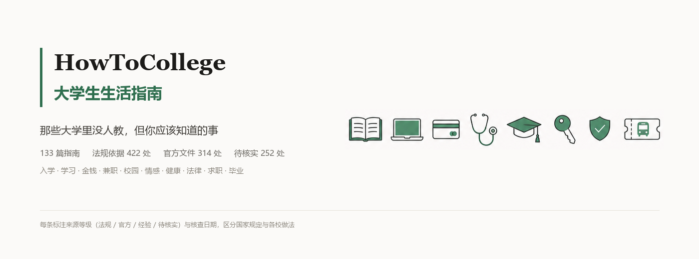

# HowToCollege · 大学生生活指南

> 那些大学里没人教，但你应该知道的事。
>
> 讲怎么少花冤枉钱、少走弯路、少踩坑，讲遇到事该找谁、该按什么顺序办。
> 每条信息标明来源和核查日期，区分「国家规定」和「某校做法」。

**在线版**：https://ruiyuxuanyan.github.io/HowToCollege/ （可筛选、可搜索）

[](#内容分类)
[](#三个核心设计)
[](#三个核心设计)
[](LICENSE)

---

## 你可能正想问

先把最常见的问题列在前面。点问题直达对应那篇，不用从目录里找。

| 你现在的处境 | 去哪看 |
| --- | --- |
| 家里凑不齐学费，是不是就没法上学了？ | [学费交不上怎么办（绿色通道）](01-大学入门/01-02-学费交不上怎么办绿色通道.md) |
| 刚收到录取通知书，一堆电话和群，哪个是真的？ | [新生入学防骗](01-大学入门/01-03-新生入学防骗.md) |
| 农村户口，迁到学校还能迁回来吗？ | [户口要不要迁到学校](01-大学入门/01-04-户口要不要迁到学校.md) |
| 家里条件一般，能申请什么钱？ | [家庭经济困难认定](01-大学入门/01-10-家庭经济困难认定.md) |
| 挂了科，还能保研吗？ | [挂科了怎么办](02-学习成长/02-12-挂科了怎么办.md) |
| 论文用了 AI，算不算学术不端？ | [论文与作业的学术规范](02-学习成长/02-10-论文与作业的学术规范.md) |
| 在不喜欢的专业，转不了怎么办？ | [转专业](02-学习成长/02-04-转专业.md) |
| 助学贷款利息高不高，要不要借？ | [国家助学贷款](03-金钱管理/03-02-国家助学贷款.md) |
| 同学让我帮他收一笔钱，再转走 | [「帮信罪」离大学生有多近](03-金钱管理/03-06-帮信罪离大学生有多近.md) |
| 有人高价租我的银行卡，能租吗？ | [银行卡与支付安全](03-金钱管理/03-05-银行卡与支付安全.md) |
| 兼职被拖欠工资，去劳动局投诉说不管 | [兼职被拖欠工资怎么办](04-兼职与赚钱/04-02-兼职被拖欠工资怎么办.md) |
| 兼职要我先交押金/培训费 | [兼职、实习的常见骗局](04-兼职与赚钱/04-03-兼职实习的常见骗局.md) |
| 室友半夜打游戏、从不打扫，怎么说？ | [宿舍关系处理](05-校园生活/05-01-宿舍关系处理.md) |
| 第一次在校外租房，合同该看什么？ | [校外租房：五查](05-校园生活/05-06-校外租房.md) |
| 一直被室友排挤、起外号 | [室友矛盾升级到欺凌](06-人际与情感/06-01-室友矛盾升级到欺凌.md) |
| 被人挂到墙上造谣了 | [网络暴力与隐私泄露](06-人际与情感/06-09-网络暴力与隐私泄露.md) |
| 分手后，之前转的钱能要回来吗？ | [恋爱期间转账能不能要回](06-人际与情感/06-04-恋爱期间转账能不能要回.md) |
| 医保到底怎么报销，回家生病怎么办？ | [医保怎么用](03-金钱管理/03-11-医保怎么用.md) |
| 室友状态很不对，我该做什么？ | [心理危机求助](07-健康与安全/07-03-心理危机求助.md) |
| 打架打出轻伤，会坐牢吗？ | [打架与寻衅滋事](08-法律与权益/08-03-打架与寻衅滋事.md) |
| 被学校处分了，能申诉吗？ | [被学校处分了怎么办](08-法律与权益/08-06-被学校处分了怎么办.md) |
| 报警了，然后呢？ | [报警之后会发生什么](08-法律与权益/08-12-报警之后会发生什么.md) |
| 签三方协议时要注意什么？ | [三方协议是什么](09-求职与就业/09-01-三方协议是什么.md) |
| 我到底还算不算应届生？ | [应届生身份到底怎么算](09-求职与就业/09-06-应届生身份到底怎么算.md) |
| 毕业了，档案去哪了？ | [档案在哪、有什么用](10-毕业与社会生活/10-02-档案在哪有什么用.md) |
| 报到证还要办吗？ | [毕业手续清单](10-毕业与社会生活/10-01-毕业手续清单.md) |
| 试用期可以随便辞退我吗？ | [试用期与劳动合同](09-求职与就业/09-11-试用期与劳动合同.md) |
| 被辞退，能拿多少钱？ | [被辞退怎么办](10-毕业与社会生活/10-06-被辞退怎么办.md) |
| 手机丢了，第一步做什么？ | [手机丢了、号被盗了](11-数字生活与效率/11-02-手机丢了号被盗了.md) |
| 怀疑自己的信息被泄露了 | [个人信息泄露的排查与止损](11-数字生活与效率/11-03-个人信息泄露的排查与止损.md) |

**没找到你的问题**？看[内容分类](#内容分类)，或者[开 issue](https://github.com/ruiyuxuanyan/HowToCollege/issues) 说一句。

## 这是什么

一份放在 GitHub 上的 **Markdown 知识库**，不是网站，不是 App。

你可以直接在这里读，也可以 clone 下来离线看，还可以 fork 一份自己改。

它想解决的问题很具体：**大学这四年里，有大量「不知道就一定会吃亏，而且吃亏时还不知道自己吃了亏」的事。**

比如：

- 兼职被拖欠工资，去劳动监察投诉，人家说不管——因为在校生勤工助学不构成劳动关系（劳部发〔1995〕309 号第 12 条），但没人告诉过你
- 签三方协议时以为是「意向书」，毁约时才知道要付违约金
- 以为毕业要办报到证——**2023 年起已经取消了**，网上的攻略全部作废
- 把银行卡借给同学「走个账」，结果涉嫌帮助信息网络犯罪活动罪

这些不是智商问题，是信息问题。

## 怎么读

- **不用全读**：这不是任务清单，是备选单。挑中你眼下的那一两条就够了，剩下的放着，需要时再回来查。
- **按问题查**：先看上面「你可能正想问」，多数高频问题都在里面。
- **按分类翻**：看下面的[内容分类](#内容分类)，11 个分类各有自己的 README 索引。
- **只看最该先看的**：看[精选指南](#精选指南)，8 篇里挑，都是「不知道就会吃大亏」的。
- **想核对原文**：每篇的参考资料来源都带【法规】【官方】标记，能点回原文。核查日期统一写在文末。
- **不确定的地方会告诉你**：标【待核实】的，是各地各校口径不一或未能取得原文的部分，文里会写清怎么自己查（打哪个电话、查哪个网站）。**这类标注不是缺陷，是明确告诉你边界在哪。**

## 它不做什么

- ❌ 不做网站、不做 App、不做小程序（纯 Markdown，零维护成本）
- ❌ 不做考研考公留学的备考资料
- ❌ 不做高校排名和择校推荐
- ❌ 不替你做决定，只把每个选项的代价讲清楚
- ❌ 不讲校内的绩点保研技巧（那是各校「Survive 生存手册」的领域）

## 三个核心设计

### 1. 四级来源标注

每个关键结论后面都标明它是什么性质的信息：

| 标记 | 含义 | 全书数量 |
| --- | --- | --- |
| 【法规】 | 法律、行政法规、部门规章原文（会给条款号） | 422 处 |
| 【官方】 | 政府部门、高校官网发布的政策与办事指南（会给文号和链接） | 314 处 |
| 【经验】 | 学生或从业者的个人经历、社区讨论（**不代表普遍情况**） | 213 处 |
| 【待核实】 | 有说法但没找到可靠来源，或来源互相冲突（会告诉你怎么自己查） | 252 处 |

这一条是本项目最重要的规矩。大学生内容最大的坑，就是把「某校规定」写成「全国规定」、把「某个学长说」写成「大家都这样」。

**252 处【待核实】不是缺陷，是诚实。** 遇到各地各校口径不一、政策正在变化、无法取得原文的情况，我们宁可标明「这条你需要自己核实」，也不编一个看起来合理的数字。

### 2. 政策适用性声明

涉及补贴、报销、办事流程的文章，开头都有：

```
> **政策适用范围**
> - 依据文件：《XXX》（文号）
> - 全国统一 / 地方执行：地方执行，以各省/各校实际为准
> - 核查日期：2026-11-05
> - 已知变化：XXX 政策 2027 年起调整
```

因为中国的很多政策是**省市甚至学校层面执行**的。写「大学生医保可以报销 70%」而不说哪个省，就是在误导人。

### 3. 数字要写，但必须标清「时间 + 地区 + 出处」

**读者最想知道的往往就是那个数字。** 所以不回避数字，但每个数字必须交代三件事：

| 要素 | 举例 |
| --- | --- |
| **政策年份** | 「2025 年度」「2024 年秋季学期起」 |
| **适用范围** | 「全国最低标准」「北京」「以当地为准」 |
| **来源** | 文件名 + 文号，或官方页面链接 |

写法示例：

> 2025 年度城乡居民医保个人缴费标准，国家规定的最低标准为每人每年 **400 元**，财政补助不低于 **670 元**；各地可高于此标准，以参保地公告为准。
>
> 【官方】国家医保局等相关部门年度城乡居民医保参保缴费通知

反过来，**这几类不写死**：

- 每年调整且调整无规律的地方标准（如各市社保缴费基数上下限）
- 各校自行规定的事项（处分细则、申诉时限）
- 无法取得当年原文的（标【待核实】，并给出查询路径）

**判断标准**：写出来的数字，能不能同时说清「哪一年、哪里、谁规定的」。三个都能答上就写，答不上就不写。

## 一篇长什么样

不是目录式的条目堆叠，每篇都按能直接照做的结构组织。以「帮信罪」那篇为例：

```markdown
## 四、「情节严重」的具体门槛

| 情形 | 门槛 | 对学生意味着什么 |
| --- | --- | --- |
| 帮助对象数量 | 3 个以上 | 帮 3 个人转钱就够了，不需要金额 |
| 支付结算金额 | 20 万元以上 | 走流水的金额，不是你赚的佣金 |
| 违法所得 | 1 万元以上 | 你实际拿到手的钱 |

【法规】法释〔2019〕15 号第十二条

## 八、六个必须破的误解

| 误解 | 实际 |
| --- | --- |
| 「我只是借一下，又没去诈骗」 | 帮信罪不要求你参与诈骗 |
| 「卡里没钱，所以没关系」 | 关键不是余额，是流经这张卡的涉案资金流水 |

## 九、可执行清单

- [ ] 检查自己有没有把银行卡、收款码、账号借给过任何人
- [ ] 用「一证通查」查名下电话卡数量
```

每篇都有：一句话概括 → 适用人群 → 政策适用范围 → 分节正文（表格/清单）→ 常见误区 → 可执行清单 → 一句话记住 → 参考资料 → 相关篇目 → 最后核查日期 → 核查说明。

## 按主题读：四条主线

11 个分类是按内容性质分的，但人的需求通常按主题来。同一个主题可以横跨几个分类。

| 主线 | 关心什么 | 主要涉及 |
| --- | --- | --- |
| **一、生存** | 权益、安全、政策、办事、防坑 | [08 法律与权益](08-法律与权益/) · [07 健康与安全](07-健康与安全/) · [03 金钱管理](03-金钱管理/) |
| **二、生活** | 宿舍、消费、饮食、出行、社交、情绪 | [05 校园生活](05-校园生活/) · [06 人际与情感](06-人际与情感/) · [11 数字生活与效率](11-数字生活与效率/) |
| **三、成长** | 学习、选课、考证、技能、认知 | [02 学习成长](02-学习成长/) · [01 大学入门](01-大学入门/) |
| **四、未来** | 兼职、实习、求职、毕业、社会生活 | [04 兼职与赚钱](04-兼职与赚钱/) · [09 求职与就业](09-求职与就业/) · [10 毕业与社会生活](10-毕业与社会生活/) |

**为什么加这一层**：如果你想的是「我得把自己的权益搞明白」，会去看 08；但如果你想的是「我担心被骗」，答案散在 03、04、07、08 四个分类里。主题入口解决的就是这个问题。

## 按阶段读：大学四年时间轴

不知道自己现在该看什么？按你的年级找。

### 入学前 · 拿到录取通知书到开学

| 要做的事 | 去哪看 |
| --- | --- |
| 报到要带什么、流程怎么走 | [报到要带什么](01-大学入门/01-01-报到要带什么.md) |
| 学费交不上怎么办 | [绿色通道](01-大学入门/01-02-学费交不上怎么办绿色通道.md) |
| 陌生电话和新生群哪个是真的 | [新生入学防骗](01-大学入门/01-03-新生入学防骗.md) |
| 户口迁不迁、档案怎么转 | [户口迁移](01-大学入门/01-04-户口要不要迁到学校.md) · [档案与组织关系](01-大学入门/01-05-录取通知书档案党团组织关系怎么转.md) |
| 家里条件一般，能申请什么 | [家庭经济困难认定](01-大学入门/01-10-家庭经济困难认定.md) · [助学贷款](03-金钱管理/03-02-国家助学贷款.md) |

### 大一 · 适应与打底

| 要做的事 | 去哪看 |
| --- | --- |
| 第一次住集体宿舍 | [宿舍生活规则](01-大学入门/01-08-第一次离开家宿舍生活.md) · [宿舍关系处理](05-校园生活/05-01-宿舍关系处理.md) |
| 不会选课、不知道绩点怎么算 | [选课怎么选](02-学习成长/02-01-选课怎么选.md) · [绩点怎么算](02-学习成长/02-02-绩点怎么算.md) |
| 医保怎么用、怎么报销 | [大学生医保政策](07-健康与安全/07-01-大学生医保政策.md) · [医保怎么用](03-金钱管理/03-11-医保怎么用.md) |
| 想赚点钱但怕被骗 | [兼职的法律身份](04-兼职与赚钱/04-01-大学生兼职的法律身份.md) · [兼职骗局](04-兼职与赚钱/04-03-兼职实习的常见骗局.md) |
| 第一次自己管钱 | [生活费怎么分配](03-金钱管理/03-01-一个月生活费怎么分配.md) |

### 大二 · 方向与技能

| 要做的事 | 去哪看 |
| --- | --- |
| 专业不喜欢，要不要转 | [转专业](02-学习成长/02-04-转专业.md) · [辅修与双学位](02-学习成长/02-05-辅修与双学位.md) |
| 想进实验室 / 做科研 | [本科生进实验室](02-学习成长/02-08-本科生进实验室.md) |
| 考证值不值、考哪些 | [考证值不值](02-学习成长/02-11-考证值不值.md) |
| 想争奖学金 | [奖学金体系全解](02-学习成长/02-03-奖学金体系全解.md) |
| 开始接触社会 | [校外租房](05-校园生活/05-06-校外租房.md) · [合同基本常识](08-法律与权益/08-10-合同基本常识.md) |

### 大三 · 分岔口

| 要做的事 | 去哪看 |
| --- | --- |
| 决定考研还是就业 | [考研还是就业](02-学习成长/02-07-考研还是就业.md) · [三条路的时间成本](09-求职与就业/09-12-考研考公就业三条路.md) |
| 想保研 | [保研推免](02-学习成长/02-06-保研推免.md) |
| 找实习、签实习协议 | [实习协议怎么签](04-兼职与赚钱/04-05-实习协议怎么签.md) · [实习受伤怎么办](08-法律与权益/08-05-实习兼职期间的伤害.md) |
| 准备简历 | [简历与作品集](09-求职与就业/09-09-简历与作品集.md) |
| 学业出问题了 | [挂科了怎么办](02-学习成长/02-12-挂科了怎么办.md) · [学术规范](02-学习成长/02-10-论文与作业的学术规范.md) |

### 大四 · 求职与离校

| 要做的事 | 去哪看 |
| --- | --- |
| 秋招春招怎么走 | [秋招春招时间线](09-求职与就业/09-02-秋招春招时间线.md) · [校招骗局](09-求职与就业/09-03-校招常见骗局.md) |
| 三方协议签不签、违约金怎么算 | [三方协议是什么](09-求职与就业/09-01-三方协议是什么.md) |
| 我还算不算应届生 | [应届生身份到底怎么算](09-求职与就业/09-06-应届生身份到底怎么算.md) |
| 入职签合同要注意什么 | [试用期与劳动合同](09-求职与就业/09-11-试用期与劳动合同.md) · [劳动合同怎么签](10-毕业与社会生活/10-03-劳动合同怎么签.md) |
| 毕业手续、档案、户口 | [毕业手续清单](10-毕业与社会生活/10-01-毕业手续清单.md) · [档案在哪](10-毕业与社会生活/10-02-档案在哪有什么用.md) |

### 毕业后 1–2 年

| 要做的事 | 去哪看 |
| --- | --- |
| 第一次独立租房 | [第一次租房](10-毕业与社会生活/10-05-第一次租房.md) |
| 工资条上扣的是什么 | [五险一金](10-毕业与社会生活/10-04-五险一金.md) · [个税](10-毕业与社会生活/10-07-个税.md) |
| 被辞退、想跳槽 | [被辞退怎么办](10-毕业与社会生活/10-06-被辞退怎么办.md) · [职场新人常见错误](10-毕业与社会生活/10-12-职场新人常见错误.md) |
| 社保断了怎么办 | [社保断缴的影响](10-毕业与社会生活/10-08-社保断缴的影响.md) · [灵活就业社保](10-毕业与社会生活/10-09-灵活就业与自由职业社保.md) |

## 内容分类

| 分类 | 讲什么 | 篇数 |
| --- | --- | --- |
| [01 大学入门](01-大学入门/) | 报到、学费、户口档案、困难认定、防骗 | 10 |
| [02 学习成长](02-学习成长/) | 选课、绩点、奖学金、转专业、考证、学术规范 | 12 |
| [03 金钱管理](03-金钱管理/) | 助学贷款、医保、校园贷、资金安全 | 12 |
| [04 兼职与赚钱](04-兼职与赚钱/) | 兼职法律身份、欠薪维权、实习协议、常见骗局 | 10 |
| [05 校园生活](05-校园生活/) | 宿舍关系、社团、校外租房、校园安全 | 11 |
| [06 人际与情感](06-人际与情感/) | 欺凌、性骚扰、师生边界、网暴、恋爱财务 | 11 |
| [07 健康与安全](07-健康与安全/) | 医保、就医、心理危机、急症、性健康、用药 | 13 |
| [08 法律与权益](08-法律与权益/) | 法律红线、帮信罪、言论边界、处分申诉、维权 | 14 |
| [09 求职与就业](09-求职与就业/) | 三方协议、应届生身份、校招骗局、试用期 | 12 |
| [10 毕业与社会生活](10-毕业与社会生活/) | 档案户口、劳动合同、五险一金、租房、个税 | 12 |
| [11 数字生活与效率](11-数字生活与效率/) | 账号安全、信息泄露、AI 使用边界、二手交易 | 11 |
| **合计** | | **133** |

每个分类的 `README.md` 里有该分类全部篇目的索引和一句话说明。

## 精选指南

如果只看几篇，先看这些：

| 篇目 | 为什么先看 |
| --- | --- |
| [大学生医保政策](07-健康与安全/07-01-大学生医保政策.md) | 每年缴费百元级，覆盖住院和门诊报销 |
| [国家助学贷款](03-金钱管理/03-02-国家助学贷款.md) | 在校期间利息由财政承担，很多符合条件的人不知道 |
| [「帮信罪」离大学生有多近](03-金钱管理/03-06-帮信罪离大学生有多近.md) | 出借银行卡、代收款的法律边界，学生群体涉案并不少见 |
| [大学生兼职的法律身份](04-兼职与赚钱/04-01-大学生兼职的法律身份.md) | 决定了被欠薪时该走仲裁还是走法院，方向错了会白跑 |
| [心理危机求助](07-健康与安全/07-03-心理危机求助.md) | 三个求助号码，出事时能立刻用上 |
| [应届生身份到底怎么算](09-求职与就业/09-06-应届生身份到底怎么算.md) | 影响考公、校招资格；各省口径近年正在放宽 |
| [毕业手续清单](10-毕业与社会生活/10-01-毕业手续清单.md) | 报到证 2023 年起取消，网上多数攻略已失效 |
| [档案在哪、有什么用](10-毕业与社会生活/10-02-档案在哪有什么用.md) | 影响考公政审、职称、退休工龄认定，补办极难 |
| [大学生最常踩的法律红线总览](08-法律与权益/08-01-大学生法律红线总览.md) | 一页看完全部高风险行为及其法律依据 |

## 当前进度

| 阶段 | 状态 |
| --- | --- |
| 第一阶段：研究与规划 | ✅ 完成 |
| 第二阶段：建设内容库 | ✅ 完成（133 / 133 篇） |
| 第三阶段：完善仓库 | ✅ 完成 |
| 第四阶段：长期维护 | 🔄 持续 |

**已完成的检查（请看清范围）：**

| 轮次 | 检查什么 | 结果 |
| --- | --- | --- |
| 第一遍 | **结构完整性**：9 项必备章节、来源标注数量、禁语、篇幅 | 133 篇全部通过 |
| 第二遍 | **链接与引用**：相对路径、交叉引用编号、标题一致性 | 0 断链、0 错编号 |
| 第三遍 | **体例与重复**：结构一致性、核查日期、相似度检测 | 体例一致，无高相似文章对 |
| 联网复核 | 对**部分**可查证的待核实项逐一核实（非全部） | 修正 13 处，含《治安管理处罚法》2026-01-01 已施行的条文变更 |

> ⚠️ **需要说清的一点**：以上三轮是**结构与体例层面**的检查，**不是逐篇逐条的事实核验**。剩余 252 处【待核实】仍未逐一查证，写作时可疑事实的准确性依赖作者自查。
>
> 我们不做「133 篇全部核实无误」这类声明，因为那需要逐条查证，目前没有做到。如果你在使用中发现事实错误，[提 issue](https://github.com/ruiyuxuanyan/HowToCollege/issues) 纠错比什么都珍贵。

## 仓库结构

```
college-student-guide/
├── README.md              # 本文件
├── CONTRIBUTING.md        # 贡献指南
├── CHANGELOG.md           # 更新日志
├── LICENSE                # CC BY 4.0
├── 01-大学入门/ ~ 11-数字生活与效率/   # 11 个分类，共 133 篇
└── docs/                  # 项目规划与写作规范
    ├── 01-项目定位与需求分析.md
    ├── 02-内容选题清单.md
    ├── 03-内容质量审核标准.md
    ├── 04-首批20篇写作顺序.md
    └── 大纲/               # 133 篇逐篇写作大纲
```

## 怎么贡献

三种方式，按门槛从低到高：

1. **提 issue 说哪里错了**——政策过时、链接失效、说法不准，附上你查到的官方来源
2. **提 issue 说你想看什么**——你踩过的坑，很可能别人也会踩
3. **提 PR 修正或新增**——按 [CONTRIBUTING.md](CONTRIBUTING.md) 的模板

不需要会写代码。所有工作都是编辑 Markdown。

**特别需要你帮忙的地方**：
- 各校各市的具体政策（我们刻意不写死数字，需要各地读者补充本地实际情况）
- 标注了【待核实】的 252 处内容，你如果能确认，欢迎补充
- 发现错误请直说，纠错比增补更有价值

## 免责声明

- 本仓库内容为**信息整理**，不构成法律意见、医疗建议或财务建议
- 政策随时可能变化，请以**最新的官方文件**为准
- 涉及具体纠纷，请咨询执业律师、医生或对应主管部门
- 【经验】标记的内容来自个人分享，**不代表普遍情况**
- 【待核实】标记的内容，我们未能取得可靠来源，请自行核实后再行动

发现问题请[开 issue](https://github.com/ruiyuxuanyan/HowToCollege/issues)。

## 许可

整个仓库（正文、`docs/`、构建脚本）采用 [CC BY 4.0](LICENSE)——可以转载、改编、商用，注明出处即可。

> 本仓库没有独立的软件项目，只有生成静态站点的构建脚本（`tools/build-site.mjs`），一并按 CC BY 4.0 处理，不再单独设 MIT 许可证。

---

**如果这份指南帮你避开了一个坑，欢迎回来补充一条你的经历。**
